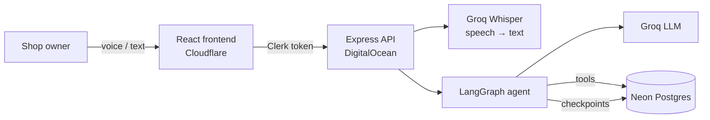
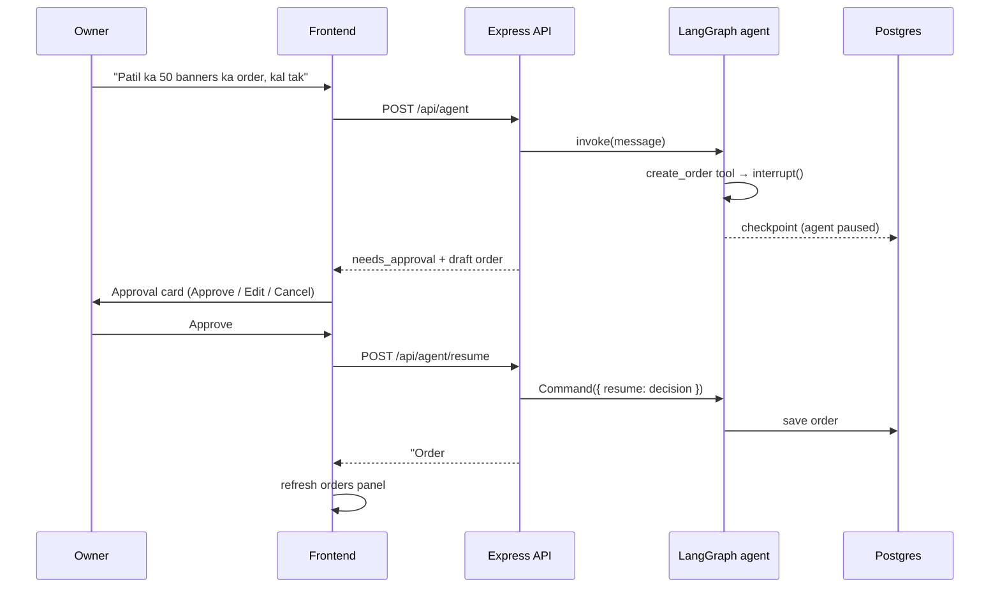

# VoiceDesk

**Speak your orders. The agent writes them. You approve every change.**

VoiceDesk is a voice-first order manager for small print and custom-order shops. The owner talks (or types) in Hindi, English or a mix of both: *"Patil ka 50 banners ka order, kal tak"*. An AI agent turns that into a structured order, and nothing is saved until the owner approves it.

🔗 **Live demo:** [voicedesk.omkarwarik1204.workers.dev](https://voicedesk.omkarwarik1204.workers.dev) (sign up with any email)

<!-- Add a screenshot or GIF of the dashboard here -->


---

## Features

- **Voice or text input.** Record in the browser with a live waveform. Speech is transcribed with Whisper, and Hinglish works.
- **An AI agent with tools.** It creates orders, lists and finds them, and changes their status. Built with LangGraph.
- **Human-in-the-loop approval.** Every write (a new order or a status change) pauses the agent and shows an approval card: **Approve**, **Edit** or **Cancel**.
- **Explainable priority.** Each order gets HIGH / MEDIUM / LOW together with the reasons, e.g. *"Why HIGH: overdue · marked urgent"*.
- **The agent drives the UI.** Ask *"Shah ka order dikhao"*, and the orders panel filters itself to match.
- **Refresh-safe approvals.** If the page reloads while an approval is waiting, the card comes back.
- **Per-user data isolation.** Every query is scoped to the signed-in user.

## How it works



### The approval flow



The agent **pauses** with LangGraph's `interrupt()`. Its state is saved in Postgres by the checkpointer, so the pause survives page reloads and server restarts. The owner's decision resumes the graph exactly where it stopped.

## Tech stack

| Layer | Technology |
|---|---|
| Frontend | React, TypeScript, Vite, Tailwind CSS v4, shadcn/ui, React Bits |
| Voice | MediaRecorder via wavesurfer.js (Record plugin), Groq Whisper (`whisper-large-v3-turbo`) |
| Backend | Node.js, Express 5, TypeScript, Zod |
| Agent | LangGraph.js, LangChain, Groq-hosted LLM |
| Database | Neon Postgres, Drizzle ORM, LangGraph `PostgresSaver` checkpointer |
| Auth | Clerk |
| Hosting | Cloudflare (frontend), DigitalOcean App Platform (backend), Neon (database) |

## Engineering decisions

**Human-in-the-loop by design.** The LLM never writes to the database directly. Write tools call `interrupt()` with a draft, and only the owner's decision (`approve`, `edit` with a corrected draft, or `cancel`) resumes them. The decision is validated with Zod before anything is saved.

**The user's identity never comes from the LLM.** The signed-in `userId` is taken from the verified Clerk token and passed to the tools through LangGraph's `RunnableConfig`. It is never a tool argument, so a prompt injection cannot make the agent act for another user.

**Per-user isolation everywhere.** Customers, orders and agent threads all carry a `user_id`. Every query filters by it, and thread ownership is checked before every invoke or resume. Another user's data returns 404, not 403.

**Explainable priority.** Priority is calculated, not stored, so it is always current:

| Signal | Points |
|---|---|
| Overdue | 50 |
| Due today | 45 |
| Due tomorrow | 30 |
| Due in 2–3 days | 20 |
| Due in 4–7 days | 10 |
| Marked urgent | 15 |
| Large order (≥ ₹5,000) | 15 |
| VIP customer | 10 |
| Advance paid | 10 |

**HIGH** ≥ 50 · **MEDIUM** ≥ 30 · **LOW** below that. The reasons are shown on every order card.

**The agent drives the UI.** When the agent calls `list_orders`, the backend returns the tool's (validated) filter arguments with the answer. The orders panel then loads with the same filter, so what you ask for in the chat is what you see.

**Cost and abuse protection.**
- Per-user rate limit on the agent routes (10 requests per minute, keyed by `userId`)
- LLM context trimmed to the last 20 messages (`trimMessages`, starting on a human message so tool calls are never split)
- Input limits: 500 characters per message, 10 MB per audio upload
- CORS allow-list and env validation with Zod at startup

## API

All routes except `/api/health` require a Clerk session token (`Authorization: Bearer …`).

| Method | Route | Description |
|---|---|---|
| GET | `/api/health` | Health check |
| POST | `/api/agent` | Send a message `{ message, threadId? }` |
| POST | `/api/agent/voice` | Send audio (`multipart/form-data`: `audio`, `threadId?`) |
| POST | `/api/agent/resume` | Resume a paused agent `{ threadId, decision }` |
| GET | `/api/agent/pending/:threadId` | Get a waiting approval, if any |
| GET | `/api/orders` | List orders (`?status=&due=&customer=`) |
| GET | `/api/orders/:id` | Get one order |

Agent responses are either `{ status: "answered", answer, toolsUsed, filter, threadId }` or `{ status: "needs_approval", approval, threadId }`.

## Project structure

```
server/
  src/
    agent/          LangGraph graph, tools, system prompt
    services/       business logic (orders, agent, transcription, priority)
    controllers/    request handlers
    routes/         Express routers
    middlewares/    auth, upload, rate limit
    validation/     Zod schemas
    db/             Drizzle schema and client
    config/         env validation
frontend/
  src/
    components/     dashboard, chat panel, approval card, order cards, landing page
    lib/            hooks: useApi, useChat, useOrders, useVoice
    types/          shared frontend types
```

## Running locally

**Prerequisites:** Node.js 24, a [Neon](https://neon.com) database, a [Groq](https://console.groq.com) API key and a [Clerk](https://clerk.com) application.

### Backend

```bash
cd server
npm install
cp .env.example .env      # fill in the values
npm run db:migrate        # create the tables
npm run dev               # http://localhost:5000
```

`server/.env`:

```
PORT=5000
DATABASE_URL=postgresql://…?sslmode=verify-full
GROQ_API_KEY=
CLERK_PUBLISHABLE_KEY=
CLERK_SECRET_KEY=
FRONTEND_URL=http://localhost:5173
```

### Frontend

```bash
cd frontend
npm install
npm run dev               # http://localhost:5173
```

`frontend/.env`:

```
VITE_API_URL=http://localhost:5000
VITE_CLERK_PUBLISHABLE_KEY=
```

## Deployment

| Part | Host | Notes |
|---|---|---|
| Frontend | Cloudflare | `npm run build`, output `dist`. `VITE_*` variables are set at build time. |
| Backend | DigitalOcean App Platform (Singapore) | Build `npm run build`, run `npm start`. Secrets are run-time env vars. |
| Database | Neon (Singapore) | Kept in the same region as the backend, because each agent turn makes several queries |

## Roadmap

- Summarise older conversation turns instead of only trimming them
- A filter chip showing what the panel is filtered by
- Editing order items in the approval form
- Conversation history
- A mobile-first layout for owners at the counter
- Multi-shop accounts with staff roles

## Author

**Omkar Warik** · [GitHub](https://github.com/omkarwarik02) · [LinkedIn](https://linkedin.com/in/omkar-warik-)
